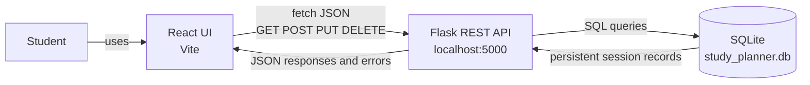

# Studyspace · Study Planner

A small React study planner backed by a Flask JSON API and a local SQLite database. Add subjects and study sessions, mark sessions complete, filter the list, and delete sessions. Session records survive server restarts.

## Run locally

Requirements: Python 3.10+ and Node.js 18+.

1. Start the API in one terminal:

   ```powershell
   cd backend
   python -m venv .venv
   .venv\Scripts\Activate.ps1
   python -m pip install -r requirements.txt
   python app.py
   ```

   Flask listens on `http://localhost:5000`. SQLite creates `backend/study_planner.db` on first start.

2. Start the frontend in another terminal:

   ```powershell
   cd frontend
   npm install
   npm run dev
   ```

   Open the local URL printed by Vite (usually `http://localhost:5173`). To point the frontend at a different API, set `VITE_API_URL` to the tasks collection URL before starting Vite.

## Build order

The project follows the requested learning path:

1. **Frontend first:** the React UI has a study-session form, list, filters, date/time inputs, and sample sessions for a quick first look.
2. **Backend:** Flask exposes `GET /api/tasks` and returns JSON.
3. **Integrate:** React loads the session list with `fetch()` when the page opens; sample sessions remain visible if the API is unavailable.
4. **CRUD:** `POST /api/tasks`, `PUT /api/tasks/<id>`, and `DELETE /api/tasks/<id>` create, update, and remove sessions.
5. **Persist:** Flask stores sessions in `backend/study_planner.db` with SQLite.
6. **Errors:** the UI shows loading state, form validation feedback, API errors, and empty states. The API validates inputs and returns JSON errors with appropriate HTTP status codes.

## API

| Method | Route | Purpose |
|---|---|---|
| GET | `/api/tasks` | List sessions in date/time order |
| POST | `/api/tasks` | Create a session |
| PUT | `/api/tasks/<id>` | Update one or more session fields |
| DELETE | `/api/tasks/<id>` | Delete a session |

Example session: `{"subject":"Biology","topic":"Cell structure","date":"2026-10-14","time":"09:00","duration":45,"completed":false}`.

## Architecture


